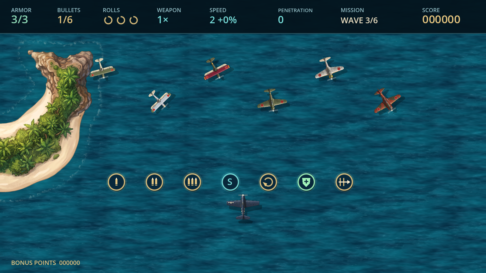
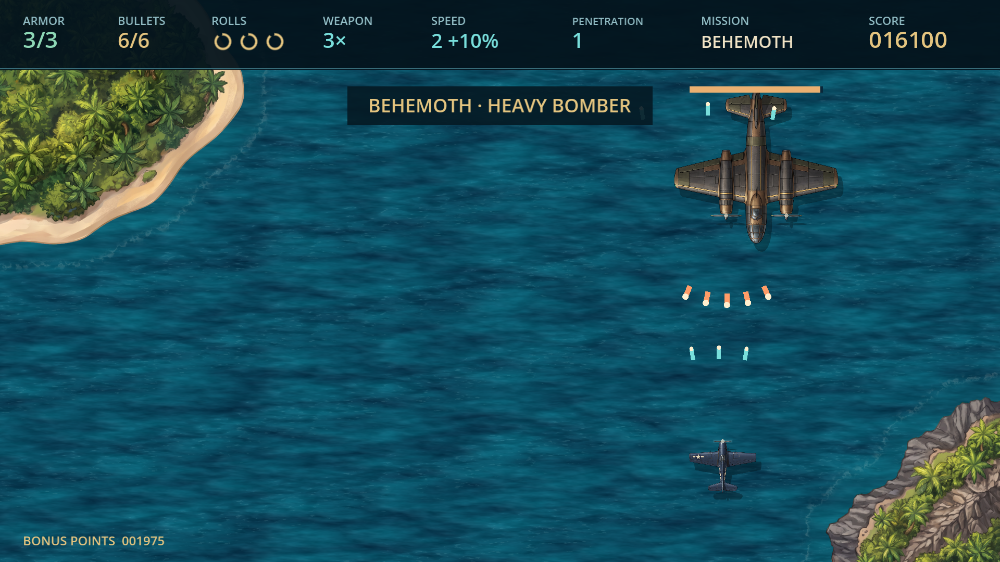
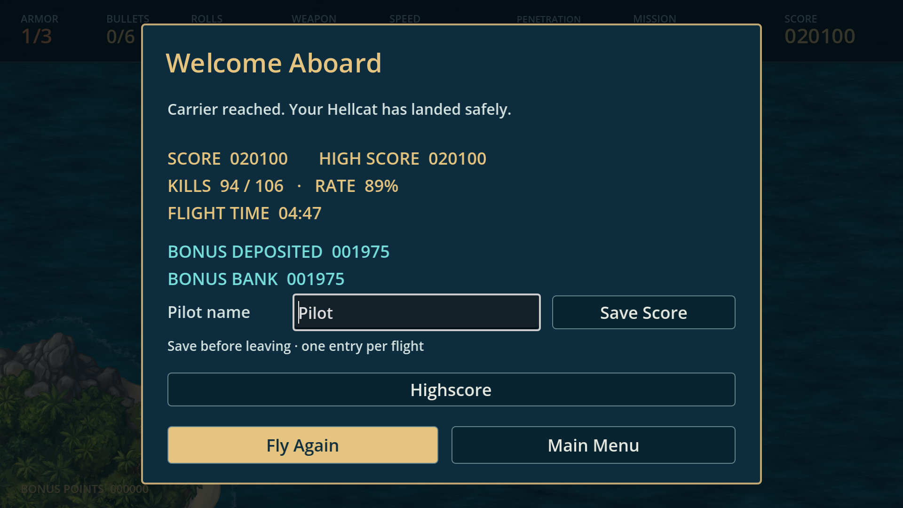
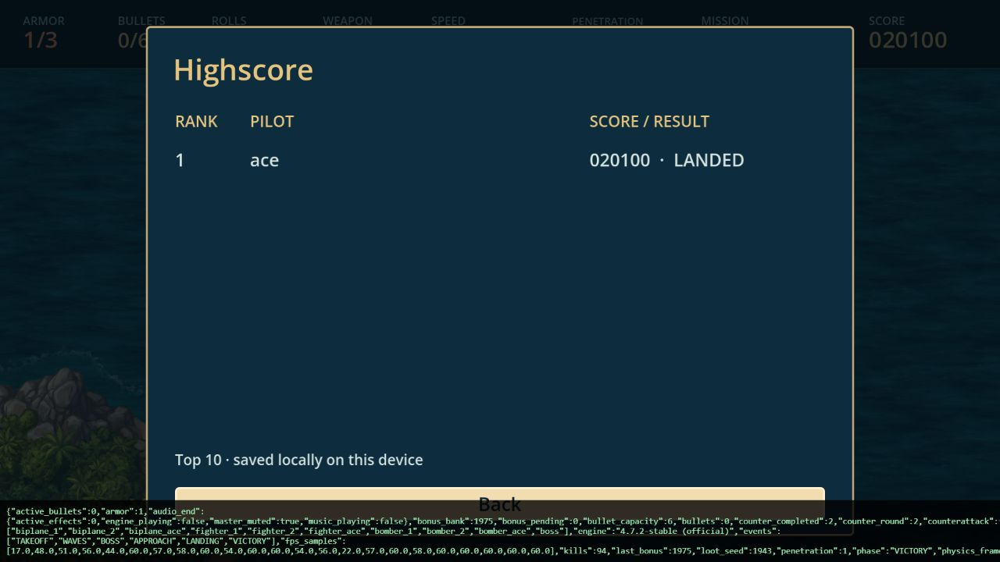
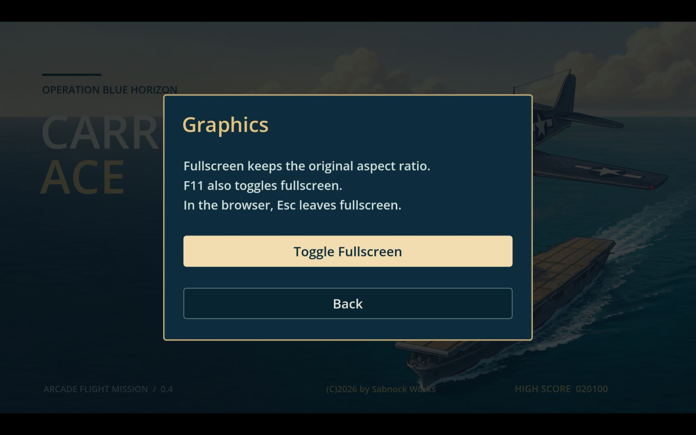

# Carrier Ace 0.4.0 – Prüfbericht

Stand: 12.10.2026. Godot 4.7.2 Standard, Compatibility, Windows x64 und Chromium/WebGL 2.

## Ergebnis

**414 automatisierte Prüfungen bestanden:** 215 Grundregeln und Geometrie, 95 Gegenangriff/Flugbahn/Waffen-/Bossprüfungen und 104 UI-, Speicher- und Audioprüfungen. Rohprotokolle: evidence/rules.json.

Der finale normale headless Flug und beide fertig exportierten Prüfflüge enden erfolgreich. Windows und Web wurden nach der Boss- und Audiokorrektur vollständig mit zwölf Simulationsschritten je Physikframe geprüft. Finale Missionswerte: 287.13 s, Counterattack 1 und 2 abgeschlossen, 94 Abschüsse bei 106 Anflügen, Score 20.100, Armor 1/3, Triple Shot, Penetration 1, Kapazität 6, keine verbleibende Rolle und 1.975 Bonus-Points. Der Pilot setzt keine Armor, überspringt keine Wellen und benutzt normale Schussimpulse.

Vor der letzten Boss-/Audiokorrektur bestanden bereits vollständige normale Windows- und Webflüge. Diese früheren Belege stehen getrennt in evidence/windows04-before-boss.json und evidence/web04-before-boss.json. Sie sind keine erneute normale Exportprüfung der letzten Änderung.

## Geprüfte Regeln

- Reserve enthält ausschließlich lebende, entkommene Mitglieder ursprünglicher Gruppen, ohne doppelte Aufnahme. Typ und Rest-Armor bleiben erhalten.
- Counterattacks nach Welle 3 und 6 stoppen die reguläre Wellenzeit. Laufende Formationen beenden ihre Bewegung; danach erscheinen neue Gruppen. Aus der Gegenwelle entkommene Gegner werden nicht endlos wiederverwendet.
- Neue Gruppen verwenden neue IDs, normale Bewaffnung und die bestehende Loot-/Bonuslogik. Neustart löscht alle Gegenangriffsdaten.
- Zickzack, vollständige Schleife, aufwärts gerichteter Teil und temporärer Seitenflug außerhalb des Bildes. Reguläre Waffen folgen der Flugzeugnase; bereits abgefeuerte Geschosse und Raketen verändern ihre Richtung nicht.
- Gedrehte Konturabmessungen und Winkelbewegung. Bisherige Bewegungs-, Penetration-, Armor- und Kapazitätsprüfungen bleiben bestanden.
- Boss behält ausdrücklich ursprüngliches seitliches Pendeln, Ausrichtung, Fächer- und gezielte Doppel-Salven sowie Rückzüge bei 200/100 Armor; keine Schleifen.
- Options/Controls/Sound/Graphics und Zurückwege, Namenseintrag nach Game Over und Landung, ein Eintrag je Flug, Top-10-Sortierung, Namensgrenze und Legacy-Rekord ohne erfundenes Ergebnis.
- ConfigFile-Persistenz sowie Erhalt von Highscore, Bonusbestand, Toneinstellungen und unbekannten Schlüsseln.

## Audio nach Spielende

Beim Abschuss stoppen Musik, Motor und MG sofort. Das Ergebnis stoppt alle Audioplayer, mutet den Master-Bus und sperrt spätere Playback-Anforderungen. Titel-Rückkehr und neue Mission heben diese Sperre bewusst auf. Quit bleibt dauerhaft stumm.

Die UI-Prüfung startet Musik, Motor und Schusseffekte, beendet den Flug und prüft Stoppen, Master-Mute, Abweisung späterer Anfragen und bewusste Wiederfreigabe. Beide finalen Exporte melden tatsächlich master_muted=true, music_playing=false, engine_playing=false, active_effects=0 unter audio_end. Prüfpiloten sind grundsätzlich stumm; eine vorherige parallele Browserprüfung war als zusätzliche Soundquelle möglich. Die Ursache des vom Nutzer gehörten Sounds wurde akustisch nicht separat aufgenommen.

## Oberfläche und Bilder

Titel, Options, Graphics, Liste und runde Upgrade-Icons wurden bei 1280×720 und 1920×1080 im gerenderten Projekt kontrolliert. Der Webexport zeigt die Namenseingabe; einzelne Tastendrücke für ace, Enter und die Highscore-Liste sind tatsächlich geprüft. Prüfpilot-Einträge bleiben im Speicher und verändern keine persönliche Liste; tatsächliche Speicherung wurde separat mit ConfigFile getestet.

Vollbild über Graphics vergrößerte die Webdarstellung sichtbar auf die Bildschirmfläche mit Randbereichen für das Seitenverhältnis. Esc stellte die ursprüngliche Größe wieder her. Die DOM-Inspektion allein stellte den Vollbildstatus in diesem Host nicht dar. Native Vollbildbedienung, physische Gamepads und persönliche Spielgefühl-/Hörabnahme bleiben getrennte offene Prüfungen.

Die Icon-Übersicht ist eine bewusst angeordnete Vorschau aller sieben Pickups; sie belegt keinen natürlichen Drop dieser sieben Items in einer Reihe.

## Leistung und Grenzen

Die normalen Läufe vor der letzten Boss-/Audiokorrektur lagen bei Windows im Median 60 und Web 60 FPS. Finale beschleunigte Läufe: Windows Median 60, Web 58 FPS. Die zwölfmal belastete Simulation ersetzt keinen normalen Benchmark der finalen Fassung. Einsekündige Stichproben, Hardware/Parallelbetrieb und Einbrüche stehen in evidence/performance.json; keine Garantie jeder Frame-Latenz oder schwächerer Hardware.

Die bekannten Godot-Cleanup-Warnungen beim Web-Quit aus 0.3 wurden nicht als behoben ausgegeben. Browser außerhalb des getesteten Hosts und akustische Aufnahme wurden nicht gesondert geprüft.

## Lieferung und Wiederholung

Windows-, Web- und Quell-ZIP tragen 0.4.0. Prüfsummen: builds/SHA256SUMS.json. Builds, Engine, Importcache und Rohentwürfe bleiben außerhalb des Git-Repositorys. Keine neuen Generierungscredits.

Prüfskripte: tests/test_core.gd, tests/test_mission04.gd, tests/test_ui.gd und tests/test_flight.gd; jeweils mit python tools/run_godot.py --headless --script starten. Exporte: python tools/build.py. Normaler Windows-Prüfflug: python tools/verify_windows.py.

Normaler Exportpilot: --verify-real-time bzw. ?verify=1&realtime=1; beschleunigt: --verify bzw. ?verify=1. Absolute beschreibbare Bericht-/Capture-Pfade verwenden. Zum Spielen Testparameter entfernen. Vorheriger Bericht: VALIDATION_0.3.md.

