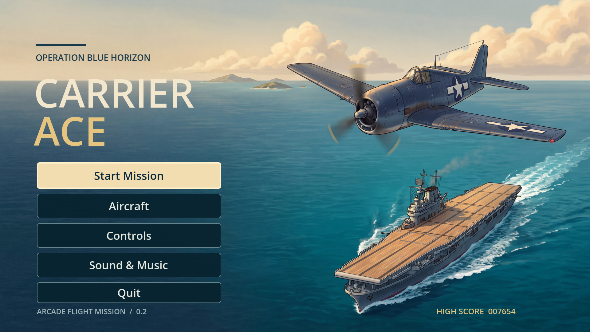
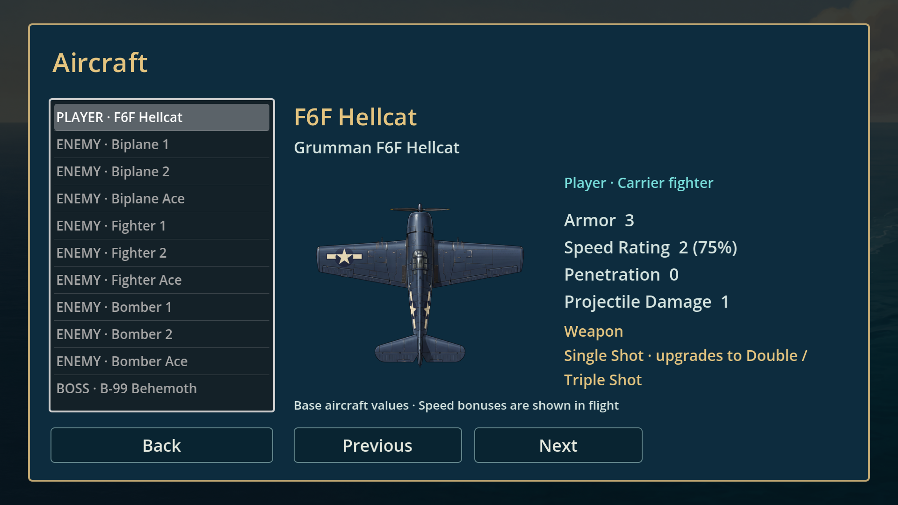

# Carrier Ace 0.2.0 – Prüfbericht

Stand: 11.10.2026. Godot 4.7.2 Standard, `4.7.2.stable.official.ed1daf0bf`, Compatibility/OpenGL 3.3 und WebGL 2. Web ohne Threads. Windows-Rechner mit NVIDIA GeForce RTX 4070 Laptop GPU; Chromium-basierter Codex-Browser.

## Ergebnis

**192 automatisierte Prüfungen bestanden:** 135 Regelprüfungen und 57 Prüfungen von Oberfläche, Speicher, Eingabe und Unterbrechungen. Windows- und Webexport haben einen vollständigen Flug in normaler Missionsgeschwindigkeit bis zur Trägerlandung abgeschlossen. Der Testpilot bewegt, schießt und rollt mit denselben Regeln wie der Spieler; er setzt keine Trefferpunkte und überspringt keine Missionszustände.

Beide Läufe: 247,25 s, sechs Wellen, alle neun regulären Gegnertypen und separater Boss, 76 Abschüsse bei 94 erzeugten Gegnern, 16.700 Punkte, drei Leben, Armor 2/3, Trippelschuss und Speed 214,5. Alle drei Rollen wurden verwendet. Nachweise: `evidence/windows.json`, `evidence/web.json`, `evidence/rules.json`. Nach den letzten Layoutkorrekturen bestanden außerdem ein zweiter normaler Windows-Flug und ein zwölfmal beschleunigter vollständiger Webflug (`evidence/web-final.json`).

| Prüfung | Ergebnis |
|---|---|
| Hellcat und neun Gegnerprofile | Grundwerte, gemeinsame Geschwindigkeitsskala und separater Boss mit Armor 300 geprüft |
| Profilgrenzen | Penetration 0–3; Geschwindigkeitsrating 1–3; alternatives Spielerprofil mit Armor 5 |
| Schadensmodell | Spielerprojektil 1; normales gegnerisches Projektil/Kollision 1; Rakete 2 |
| Ki-21-Raketen | 0,6 s Warnung, gesperrte Zielrichtung, kein Nachführen nach Abschuss |
| Ace-Doppelschuss | Zwei getrennte Geschosse |
| Reparatur | +1, keine Überschreitung des Profilmaximums |
| Speed | 195 → 214,5 → 234 → 253,5 → 260; weitere Pickups ohne Überschreitung oder Änderung der Grundstufe |
| Waffen | Ein-/Doppel-/Trippelschuss; schwächere Pickups senken die Stufe nicht |
| Penetration | Für 0–3 jeweils höchstens ein bis vier unterschiedliche Ziele, kein Mehrfachschaden an derselben ID |
| Schnelle Geschosse | Segmentbasierte Kollisionsprüfung |
| Versorgung | Vier eindeutige Abschüsse erzeugen einen Drop; Entkommen verhindert ihn; gleichzeitige/doppelte Auflösung sicher |
| Drop-Lebensdauer | Sammlung einmalig, Verfall nach zwölf Sekunden |
| Schutz | Drei Rollen, 1 s Schutz, Trefferschutz 0,6 s |
| Drei Flugzeugverluste | Erste zwei starten dieselbe Mission von vorn; dritter führt zu Game Over |
| Vollständiger Neustart | Armor, Waffe, Speed, Rollen, Gegner, Geschosse, Formationen, Drops, Effekte, Zeit und Punkte zurückgesetzt |
| Landung | 0,75 s kontinuierlicher Korridoraufenthalt; Verlassen setzt Haltezeit zurück; Wiederholung ohne Lebensverlust |
| Aircraft | Elf Einträge aus echten Mission-Ressourcen; Auswahl, Vor/Zurück, Tastatur- und simulierte D-Pad-Navigation |
| Pause und Aircraft aus Pause | Mission, Wasser und Inselroute bleiben angehalten; Esc kehrt zur Pause zurück |
| Hintergrundkontinuität | Wellen/Boss/Anflug/Landung erhalten dieselben Koordinaten; Reset beginnt bei null; Insel-Culling erst vollständig außerhalb |
| Fokusverlust / Gamepad-Trennung | Callbacks in fünf Flugphasen geprüft; bewusste Fortsetzung |
| Speicher | Highscore und Toneinstellungen im isolierten Windows-Testprofil gespeichert und gelesen |
| Audio | Eingabefreischaltung, Loop-Flags, Pause/Fortsetzung und fehlende Sounds ohne Absturz |
| Sprache | Hauptmenü, Übersicht, HUD, Meldungen, Ergebnis, Web-Ladebild und Serverausgaben Englisch |

## Grafik und Leistung

Titel, Aircraft, Küstenbereich, HUD, Spieler, Gegner und Landekorridor wurden bei 1280×720 und 1920×1080 im GPU-gerenderten Projekt geprüft. Zusätzliche Kontrolle im tatsächlichen Windows-Export sowie Webexport, dort auch in einer schmalen Browserfläche mit freien Rändern. Lange Waffenbeschreibungen wurden nach einer gefundenen Überbreite umgebrochen und mit Abstand zum Fußtext angeordnet.

Das Titelbild zeigt eine einmotorige Hellcat; die grauen Schattenbalken und der frühere Untertitel entfallen. Spieler und Gegner besitzen klare Tragflächen und getrennte Leitwerke. Die Propelleranimation folgt den profilbezogenen Motorpositionen. Ki-21 und B-99 sind zweimotorig; ihre Motorpunkte wurden anhand der fertigen Sprites angepasst.

Sechzehn hochauflösende Bilder liegen lokal vor. Alle freigestellten Assets besitzen vollständig transparente äußere Pixelränder; Größen und fehlende Farbquantisierung stehen in `evidence/art02.json`. Küstenmasken ergänzen weiche, unregelmäßige Brandung. Das Meer bewegt sich unabhängig vom schnellen Gegneranflug; die 5,4-Pixel/s-Route entspricht 2,47 Bildschirmhöhen im erfolgreichen Prüfflug. Phasenwechsel erzeugen keine Einblendung oder Positionssprünge.

Die FPS-Rohdaten stehen in beiden Exportberichten und zusammengefasst in `evidence/performance.json`. Einsekündige Engine-Stichproben ersetzen keine Messung jeder einzelnen Frame-Latenz. Beim ersten parallelen Windows-/Weblauf lag der Windows-Median nach dem Start bei 60 FPS; vier Stichproben lagen unter 59, Minimum 29 (`evidence/windows-parallel.json`). Beim abschließenden Windows-Lauf lag der Median erneut bei 60, Minimum 28, fünf von 246 Stichproben unter 59. Exporttests fertigen während des Flugs Bildschirmaufnahmen an; der Einfluss dieser Aufnahmen wurde nicht separat gemessen. Im normalen Webflug lagen die Stichproben nach dem Start bei 59–62, Median 60, keine unter 59. Startwerte des abschließenden Windows- und normalen Weblaufs: jeweils 2 FPS. Eine durchgehende 60-FPS-Garantie oder Aussage über schwächere Geräte folgt daraus nicht.

Im tatsächlichen Webexport wurden Hauptmenü, Controls, Aircraft und die Ki-21-Detailansicht mit Tastatur und Maus bedient. Die Musiklautstärke wurde von den vorhandenen 45 % auf 30 % geändert, nach Neuladen wieder bei 30 % vorgefunden und anschließend auf 45 % zurückgesetzt. Aircraft aus der Pause blieb angehalten; Esc kehrte zur Pause zurück, Resume setzte die Mission fort. Die Browserkonsole zeigte in diesen Prüfungen und beim abschließenden vollständigen Flug keine Warnungen oder Fehler. Nachweise: `evidence/browser-ui.json`.

## Audio und Budget

Audio aus 0.1 bleibt unverändert: elf Effekte einschließlich Motor und zwei instrumentale Musikstücke mit Tracker-Anmutung. Motor und Musik werden als Ogg-Streams abgespielt; technische Schleifen- und Pegelwerte sind in `evidence/assets01.json` erhalten. Die Aufbereitung ist kein Ersatz für eine menschliche Hörabnahme.

Runway 0.2: **340 von höchstens 500 zusätzlichen Credits**, fünfzehn 2K-Bilder zu 20 und ein 4K-Titel zu 40. Anfangs waren 100 Credits für Korrekturen reserviert. 160 Credits bleiben ungenutzt; keine Käufe. Lokale Freistellung, Größenanpassung und Shader kosten keine Generierungscredits. `assets/revision02.json` enthält Aufgaben und Prompts ohne signierte Downloadlinks. Der ursprüngliche Verbrauch von 138/200 Credits bleibt separat in `assets/manifest.json`.

## Lieferung und Wiederholung

- Windows: `CarrierAce-0.2.0-Windows-x64.zip`, portabler x64-Build.
- Web: `CarrierAce-0.2.0-Web.zip`, lokale Engine-/Spieldateien, HTTP-Server und Startskripte.
- Quelle: `CarrierAce-0.2.0-Source.zip`, Projekt, fertige Assets, Tests und deutsche Dokumentation.
- SHA-256-Prüfsummen: `builds/SHA256SUMS.json`.
- Git: `main` im GitHub-Repository; Builds, Engine, Cache und Rohentwürfe sind ausgeschlossen.

```powershell
python tools/run_godot.py --headless --script tests/test_core.gd
python tools/run_godot.py --headless --script tests/test_ui.gd
python tools/build.py
python tools/verify_windows.py
```

`verify_windows.py` startet den tatsächlichen Export bei 1920×1080 mit normalem Testpiloten und isoliertem Windows-Speicherprofil. `--verify` bzw. Web-`?verify=1` beschleunigt die Simulation zwölfmal; `--verify-real-time` bzw. `?verify=1&realtime=1` läuft normal. Während Webtests einmal die Spielfläche anklicken oder eine Taste drücken. Zum eigenen Spielen Parameter entfernen.

## Grenzen der Abnahme

Eine physische Gamepad-Verbindung/-Trennung, persönliche Schwierigkeit und Spielgefühl sowie eine menschliche Hörabnahme sind noch offen. Simulierte Eingaben und Callback-Tests sind getrennt davon dokumentiert. Browser außerhalb des verwendeten Chromium-Hosts, mobile Geräte, blockierter Speicher und schwächere GPUs wurden nicht gesondert geprüft. Der Windows-Build ist nicht digital signiert.






