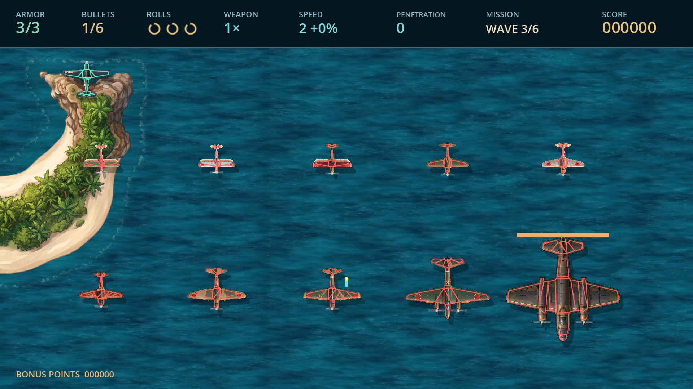
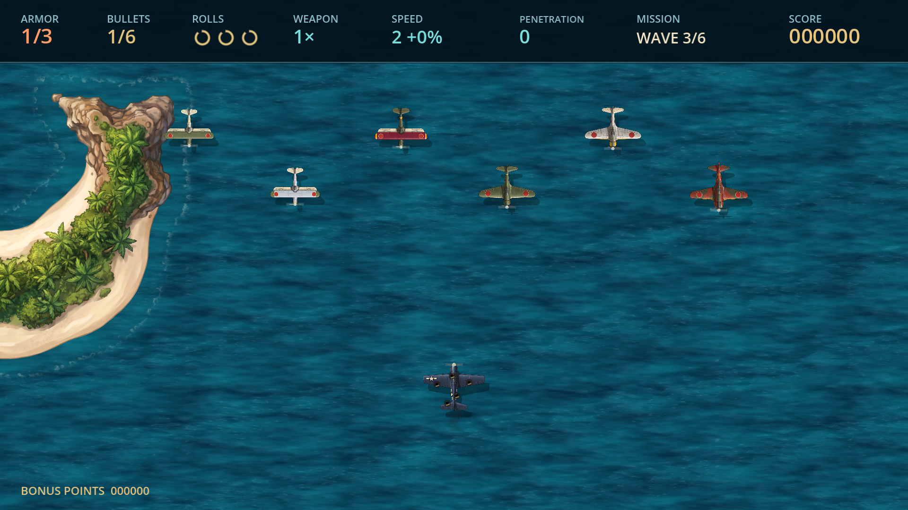
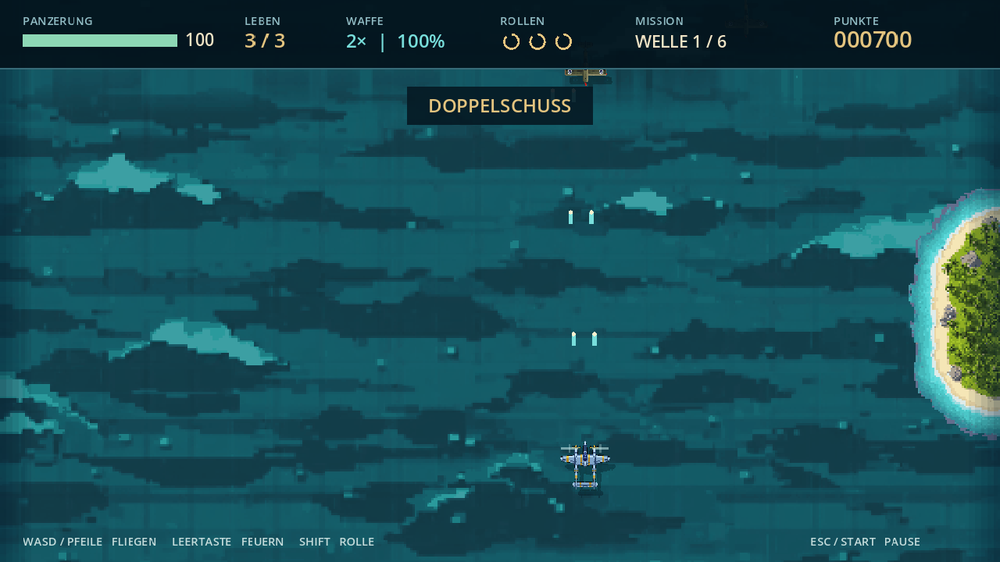
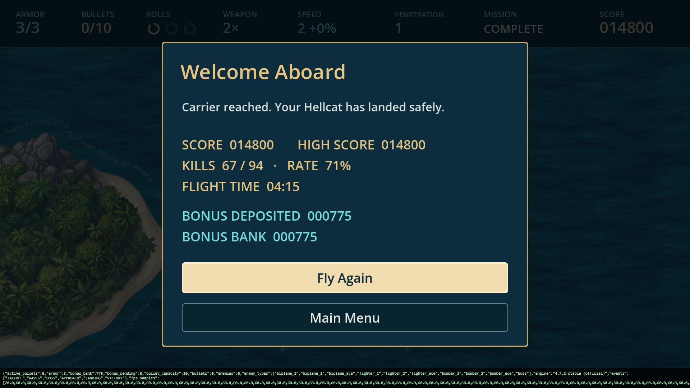

# Carrier Ace 0.3.0 – Prüfbericht

Stand: 12.10.2026. Godot 4.7.2 Standard (`4.7.2.stable.official.ed1daf0bf`), Compatibility/OpenGL 3.3, WebGL 2 ohne Threads. Testrechner: NVIDIA GeForce RTX 4070 Laptop GPU; Web im Chromium-basierten Codex-Browser.

## Ergebnis

**297 automatisierte Prüfungen bestanden:** 214 Regel- und Geometrieprüfungen, 83 Prüfungen von Oberfläche, Eingabe, Speicherung und Unterbrechungen. Zusätzlich besteht ein vollständiger headless Prüfflug mit normalem Testpiloten. Der Pilot benutzt echte Bewegung, einzelne Schussimpulse, Konturprognosen und Rollen; er verändert weder Armor noch Gegnerzustände und überspringt keine Missionsabschnitte.

Windows- und Webexport haben den vollständigen normalen Flug bestanden: 255,90 s, alle sechs Wellen, alle neun Gegnerarten und separater Boss, Trägeranflug und Landung. Beide Läufe enden mit 67 Abschüssen bei 94 Gegnern, Score 14.800, Armor 3/3, Kapazität 10, Double Shot, Penetration 1, einer verbleibenden Rolle und 775 gutgeschriebenen Bonus-Points.

Nachweise: `evidence/rules.json`, `evidence/windows.json`, `evidence/web.json`. Die aktuellen Flüge verwenden zur Wiederholung Loot-Seed 1943. Echte Flüge randomisieren Loot. Die Export-Prüfmodi speichern keine persönlichen Einstellungen; die Bonus-Gutschrift wird dort im Speicher angezeigt. Positive Gutschrift, Neuladen, Verlust und Altstand-Kompatibilität werden separat über den tatsächlichen Einstellungs-Code geprüft.

## Regeln, Eingabe und Speicherung

| Prüfung | Ergebnis |
|---|---|
| Elf Konturprofile | Rumpf, linker/rechter Flügel und Leitwerk getroffen; transparente Zwischenräume, Außenseite und Randtoleranz verfehlt |
| Konturaufbereitung | Alle gespeicherten Polygonvertices liegen auf festen Spritepixeln mit Alpha mindestens 192; Generator reproduziert die Ressourcen unverändert |
| Bewegung | Geschossbreite, Streifkontakt, bewegtes Ziel und kontinuierlicher Flugzeugkontakt geprüft |
| Raketen | Länglicher Körper zählt, Abgas nicht; zwei Armor-Punkte; Warnung und gesperrte Richtung bleiben erhalten |
| Penetration | 0–3: ein bis vier unterschiedliche Gegner; kein Mehrfachtreffer durch überlappende Teilflächen |
| Reihenfolge | Tatsächliche erste Konturberührung vor Abstand zur Gegner-Mitte |
| Renderbreite | Kurvenflug und Trefferfläche teilen dieselbe Breitenfunktion |
| Spielfeldrand | Vollständiges Spielersprite unter HUD sichtbar; Kugelplatz wird beim körperlichen Austritt frei, ohne unsichtbare Nachlaufzone |
| Armor / Game Over | Drei normale Treffer bzw. passende Raketenmischung; Explosion vor Game Over nach 0,8 s; kein automatischer Neustart |
| Schutz | 0,6 s Trefferschutz; drei einsekündige Rollen; vierte ohne Ladung unmöglich |
| Bordkanone | Ganze Single/Double/Triple-Salven; Platzmangel verwirft den Druck; Abkühlzeit verwirft Eingaben ohne Nachholen |
| Tastatur | Ein Druck, Halten, Echo, Loslassen und neuer Druck über echte InputEvents geprüft |
| Gamepad | A, Halten, Loslassen, zweiter Druck und tatsächlicher GUI-Resume geprüft; Menüaktion erzeugt keinen Schuss |
| Menüzustand | Aircraft aus Pause bleibt angehalten; Esc kehrt zur Pause zurück; keine gespeicherten Menü-Schüsse |
| Upgrade-Grenzen | Kapazität 6→18, Penetration 0→3, Rollen maximal drei, Reparatur bis Profilmaximum, Speed bis 260 |
| Profilwerte | Boni ändern keine Grundressourcen; fliegende Geschosse behalten ihre Abschuss-Penetration |
| Loot | 3-%-Grenze mit kontrollierter Zufallsfolge; alle Tabellenintervalle; Rockets mit Gewicht null |
| Nutzlose Pickups | +25 Bonus-Points; keine Waffenabstufung |
| Gruppen | Vollständig, entkommen, gleichzeitig zerstört und doppelt aufgelöst: korrekte einmalige Belohnung |
| Reguläre Gruppen | Bonus-Gruppenzugehörigkeit unterdrückt keine gegnerischen Angriffe |
| Punkte | Landung schreibt einmal gut; doppelte Erfolgsereignisse werden ignoriert; Game Over/Abbruch verlieren nur ungesicherte Punkte |
| Lokaler Speicher | Positiver Bankbestand gelesen; Altstand ohne Bank startet bei null; Score, Tonwerte und unbekannte Schlüssel erhalten |
| Fokus / Trennung | Pause-Callbacks in fünf Flugphasen sowie bewusste Fortsetzung geprüft |
| Audio | Eingabefreischaltung, Ogg-Loops, Pause/Fortsetzung und fehlende Dateien ohne Absturz |
| Landung | Kontinuierlicher Aufenthalt 0,75 s; Verlassen setzt Haltezeit zurück; Wiederholung ohne Armor-Verlust |

Bei der erweiterten Gamepad-Prüfung fehlte die A-Zuordnung im Standard-`ui_accept`. Menü-A und D-Pad sind jetzt ausdrücklich und für alle Geräte zugeordnet. Der anschließende GUI-Resume-Test besteht und feuert nicht versehentlich.

## Sichtprüfung und Browser

Titel, Controls, Aircraft, Hellcat-Kapazität, Ki-21, normales Spiel, Konturansicht, Armor 2/1 und Landung wurden bei 1280×720 sowie 1920×1080 im GPU-gerenderten Projekt kontrolliert. Zusätzlich wurden tatsächliche Windows-Screenshots und der normale Webflug geprüft.

Die Diagnose zeigt elf individuelle feste Umrisse, einschließlich Motorgondeln und freier Bereiche zwischen Flügeln und Leitwerk. Unschärfe und der versetzte Schatten sind ausgeschlossen. Die Vorbereitung verwendet meist zwei Pixel Randtoleranz, am schmalen Rumpf einen Pixel; die Konturvereinfachung beträgt höchstens einen halben Pixel. Nachweise: `evidence/geometry03.json`, `evidence/contour-opacity.json`.

Brandungsmasken messen 1216×960 bei 96 zusätzlichen Texturpixeln Rand je Seite. Alle Außenränder sind null. Landmaßstab und Mittelpunkt stimmen mit der Maske überein; Culling umfasst die vollständige Brandung. Die Missionsroute bleibt beim Wechsel zwischen Wellen, Boss und Landung kontinuierlich; Pause und Neustart sind geprüft.

Die Aircraft-Werte und Waffenbeschreibung überlappen nicht. Ein im Web nicht verfügbarer Pfeil-Glyph wurde durch eine einfache ASCII-Trennung ersetzt. HUD und aktuelle Menüs enthalten keine Lives-Anzeige und keine untere WASD-/ESC-Legende.

Im tatsächlichen Webexport wurden Aircraft mit Tastatur geöffnet und die Ki-21 per Maus ausgewählt. Controls und Sound wurden bei 1280×720 bedient. Die Musik wurde um einen Schritt von der vorhandenen Reglerposition nach links geändert; nach Neuladen lag der Regler wieder an dieser Position. Anschließend wurde die ursprüngliche Position wiederhergestellt. Der normale vollständige Flug zeigte keine Warnungen oder Fehler in der Browserkonsole. Nachweise: `evidence/browser-ui.json`.

## Leistung

Beide Plattformen erreichen im Median 60 FPS. Nach dem Start: Windows 31–60 FPS, fünf von 254 Stichproben unter 59; Web 8–60 FPS, sechs von 254 Stichproben unter 59. Startwerte: Windows 11, Web 20. Die einzelnen erheblichen Einbrüche bleiben im Rohbericht sichtbar; ihre Ursache wurde nicht separat isoliert.

Die Werte sind einsekündige Engine-FPS-Stichproben, keine Messung jeder einzelnen Frame-Latenz. Windows-/Webprüfungen, Bildschirmaufnahmen und weitere QA-Arbeiten liefen teilweise parallel. Eine durchgehende 60-FPS-Garantie oder Aussage über schwächere Hardware folgt daraus nicht. Rohdaten stehen in beiden Exportberichten; Zusammenfassung in `evidence/performance.json`.

## Lieferung und Wiederholung

Windows-x64-ZIP, Web-ZIP und Quell-ZIP tragen Version 0.3.0. SHA-256-Prüfsummen stehen in `builds/SHA256SUMS.json`. ZIP-Integrität, erforderliche Dateien und Ausschluss von Engine, Rohentwürfen, Importcache und Builds aus dem Quellarchiv werden geprüft. Die Windows-EXE enthält ihr Spielpaket eingebettet.

```powershell
python tools/run_godot.py --headless --script tests/test_core.gd
python tools/run_godot.py --headless --script tests/test_ui.gd
python tools/run_godot.py --headless --script tests/test_flight.gd
python tools/build.py
python tools/verify_windows.py
```

Windows-Diagnose: `CarrierAce.exe -- --collisions`; Web: `?collisions=1`. Exportprüfung normal: `--verify-real-time` bzw. `?verify=1&realtime=1`; beschleunigt: `--verify` bzw. `?verify=1`. Im Browser die erste Eingabe zur Audiofreigabe geben; zum eigenen Spielen Testparameter entfernen.

Audio aus 0.1 und Grafiken aus 0.2 bleiben erhalten. 0.3 ergänzt Konturen, Schadenszeichnung und Brandungsrand lokal: **keine weiteren Runway-Credits**. Vorherige Generierungen und deren Verbrauch bleiben in den ursprünglichen Manifesten dokumentiert.

## Grenzen

Physisches Gamepad-Anschließen/-Trennen, eine menschliche Hörabnahme und persönliche Schwierigkeit bzw. Spielgefühl sind noch offen. Simulierte Geräte und Callback-Prüfungen sind getrennt davon erfasst. Browser außerhalb des verwendeten Chromium-Hosts, blockierter Speicher, mobile Geräte und schwächere GPUs wurden nicht gesondert geprüft. Der Windows-Build ist nicht digital signiert.










## Nachtrag: Credits und Audio-Ende

Das Hauptmenü enthält Credits und Quit auf Windows und Web. Credits nennen 1942 (1984), Yoshiki Okamoto und Capcom als ursprüngliche Idee, Sabnock Works und Michael Kahler, ausschließlich OpenAI ChatGPT als Programming Support und Runway AI für Sounds, Musik und Assets. Keine Visit-also-Zeile. Quellenbezug: https://www.arcade-museum.com/Videogame/1942--capcom

83 UI-Prüfungen bestanden, einschließlich Credits/Zurück, vollständigem Audiostopp am Ergebnis, Wiederaufnahme der Titelmusik, Fokusverlust und permanentem Shutdown. Credits bei 1280×720 und 1920×1080 kontrolliert. Web-Quit und Neustart über die Abschlussseite tatsächlich geprüft. Beide Exporte neu gebaut; der vollständige Flug und die FPS-Daten oben stammen aus der zuvor geprüften 0.3.0-Fassung, vor diesem Menü-/Audio-Nachtrag. Keine erneute menschliche Hörabnahme.

Beim tatsächlichen Web-Quit meldet Godot zusätzlich interne Cleanup-Warnungen (ObjectDB/WorkerThreadPool, zwei Ressourcen). Die Exit-Seite erscheint und ein Neustart funktioniert; die Warnungsursache wurde nicht isoliert. Der Audiostopp und Schutz vor erneutem Start sind separat automatisiert geprüft.
