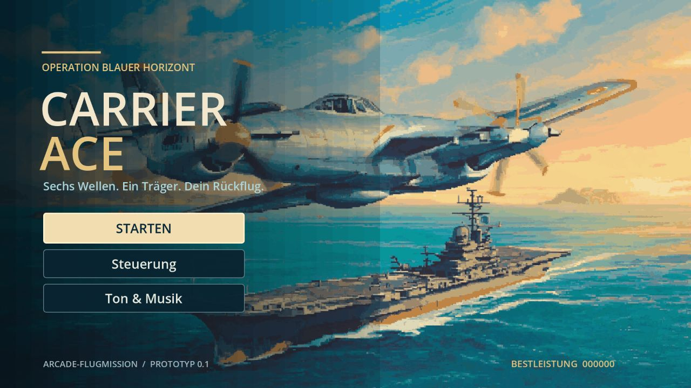
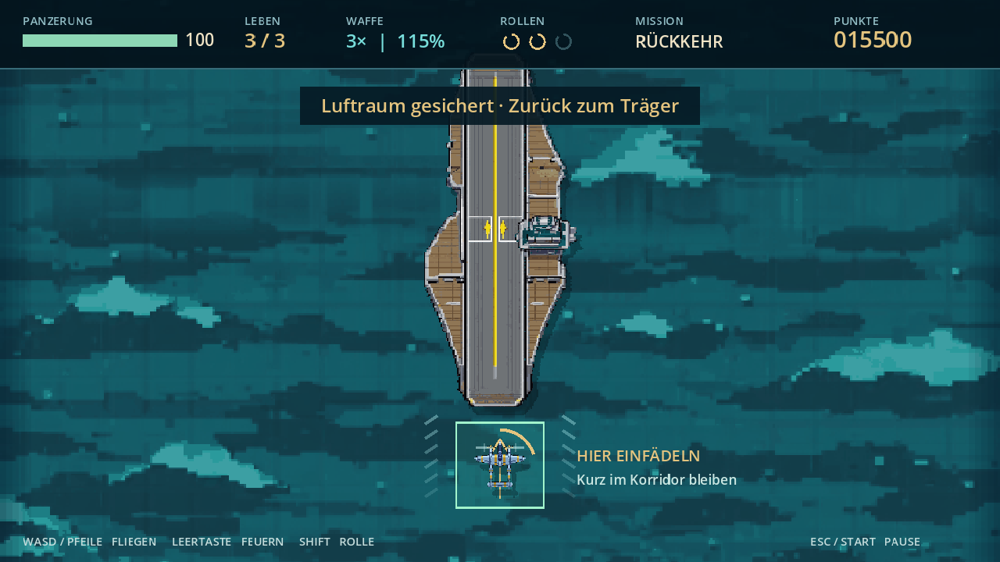

# Carrier Ace 0.1.0 – Prüfbericht

Stand: 11.10.2026. Godot 4.7.2 Standard, `4.7.2.stable.official.ed1daf0bf`, Compatibility/OpenGL 3.3 bzw. WebGL 2; Webexport ohne Threads. Geprüft auf dem vorhandenen Windows-Rechner mit NVIDIA GeForce RTX 4070 Laptop GPU und im Chromium-basierten Codex-Browser.

## Ergebnis

**109 automatisierte Prüfungen bestanden:** 78 Regelprüfungen und 31 Prüfungen von Menüs, Speicher und Unterbrechungen. Zusätzlich haben der tatsächlich ausgeführte Windows-Export und der Webexport einen vollständigen Flug bis zur erfolgreichen Landung abgeschlossen. Der gemeinsame Testpilot steuert Bewegung, Schuss und Rolle; er verändert weder Trefferpunkte noch Gegnerwerte und überspringt keine Missionszustände.

Die Exportprüfungen laufen mit zwölf normalen 1/60-s-Modellschritten pro Physiktakt. Das beschleunigt den Prüfflug, erhält aber Kollisionen, Gegner und Wellenzeiten. Ein automatisch gewonnener Flug ist keine menschliche Abnahme des Schwierigkeitsgrads.

| Prüfung | Ergebnis / Nachweis |
|---|---|
| Start → sechs Wellen → Bomber → Anflug → Landung → Ergebnis | Windows und Web PASS, siehe `evidence/windows.json` und `evidence/web.json` |
| Missionsergebnis | 235,42 s Missionszeit, 94/94 Gegner, 16.500 Punkte, drei Leben; 100 Panzerung, Trippelschuss, zwei Rollen übrig |
| Versorgungsformation vollständig | Vier eindeutige Abschüsse erzeugen genau einen Drop |
| Mitglied entkommt / doppelte Auflösung / mehrere Abschüsse im selben Schritt | Kein falscher oder doppelter Drop |
| Waffen | Doppel-/Trippelschuss, keine Herabstufung durch schwächeren Pickup |
| Panzerung, Speed, Drops | Reparatur +30 mit Maximum, Speed +15% bis 130%, Ablauf nach zwölf Sekunden |
| Durchschlagen | Zwei unterschiedliche Ziele; segmentbasierte Treffer, kein erneuter Schaden am selben Ziel |
| Schutzrolle und Trefferschutz | Genau drei Einsätze je Versuch, eine Sekunde Schutz; 0,6 s Schutz nach Schaden |
| Drei Flugzeugverluste | Erste zwei setzen die ganze Mission zurück; dritter führt zu Game Over |
| Rücksetzen | Werte, Punkte, Wellen, Gegner, Formationen, Geschosse, Drops und Effekte zurückgesetzt |
| Landekorridor | 0,75 s durchgehender Aufenthalt, Verlassen setzt nur Haltezeit zurück; neuer Anflug ohne Lebensverlust |
| Pause | Keine Bewegung, Wellenzeit oder Schadensfortschreibung während Pause |
| Fokusverlust / Gamepad-Trennung | Callback-Prüfungen in Start, Kampf, Boss, Anflug und Landung; bewusste Fortsetzung |
| Tastatur / Gamepad-Eingabemapping | Tastaturereignisse, simulierte Gamepadbuttons und Achsen geprüft; keine physische Hardwareabnahme |
| Menüs | Tastatur-/Gamepad-Fokus, Steuerungsseite, Tonregler, Pause-Untermenü und neuer Durchlauf geprüft |
| Lokaler Speicher | Highscore und Toneinstellungen mit isoliertem Windows-Testprofil erfolgreich geschrieben und gelesen |
| Browser-Speicher und normale Bedienung | Musik von 60% auf 45% gestellt, nach Neuladen erhalten; Start per Enter sowie Pause/Steuerungsmenü per Tastatur geöffnet |
| Audio | Freischaltung, erforderliche Loop-Flags, Pause/Fortsetzung und fehlende Soundeinträge ohne Absturz geprüft |
| Weblaufzeit | Vollständiger Prüfflug; nach Nutzerinteraktion keine Fehler oder Warnungen im Browserprotokoll |

## Grafik, Audio und Leistung

Spieler, drei Gegner, Boss, Träger und Insel besitzen transparente äußere Pixelränder. Ihre Silhouetten wurden im Kontaktbogen und im tatsächlichen Spielbild kontrolliert. Titel, HUD, Boss und Einflugbereich wurden visuell geprüft. Bilder verwenden eine begrenzte Palette und Pixelraster; die große Weltansicht skaliert unter Beibehaltung des Seitenverhältnisses. Die Ansicht wurde auch in einer schmalen Browserfläche mit freien Randbereichen geprüft.

`evidence/assets.json` hält Größen und Audioaufbereitung fest. Elf Effekte einschließlich Motor sowie zwei Musikstücke liegen als lokale Ogg-Dateien vor. Die Musik ist instrumental mit Tracker-Anmutung, kein MOD-Format. Der Motor und die beiden Musikstücke sind durch Überblendung auf Schleifen vorbereitet. PCM-Spitzen vor Ogg-Encoding: Effekte 0,708, Musik 0,5. Gemessene maximale Sprünge zwischen letztem und erstem Sample: Motor 0,006873, Titel 0,000534, Spielmusik 0,001083. Diese technischen Werte ersetzen keine Hörprüfung von Klang, Mischung oder Schleifenübergängen.

Im Windows-Prüfflug lagen die meisten einsekündigen FPS-Stichproben bei 60; 3 beim Start, einmal 42 und einmal 59 sind ebenfalls im Rohbericht enthalten. Während dieses Laufs waren Export-/Dateiarbeiten aktiv. Im Weblauf: erste Stichprobe 48, danach abwechselnd 59/61. Damit wurde der Zielbereich auf diesem Rechner erreicht; eine durchgehende 60-FPS-Garantie oder eine Aussage über schwächere Geräte ist daraus nicht ableitbar. `physics_frames` zählt Physiktakte, `processed_seconds` deren verarbeitete Zeit; nur `fps_samples` misst die Engine-Bildrate.

Lange Musik und Motor verwenden Stream-Wiedergabe. So werden große Web-Audio-Samplepuffer und deren wiederholte Duplikation beim Pausieren vermieden. Kurze Effekte bleiben getrennte Stimmen. Der endgültige Web-Prüfflug enthält den Fix und zeigt keine Audiofehler.

Runway-Verbrauch: **138 von 200 Credits**, Bilder 108, Effekte 18, Musik 12. Verworfene Bildentwürfe sind enthalten. 62 Credits ungenutzt; keine zusätzlichen Käufe. Aufgaben und Prompts ohne signierte Downloadlinks stehen in `assets/manifest.json`.

## Lieferung und Wiederholung

- Godot-Projekt mit eigenen Ressourcen und lokalem Git auf `main`, ohne Remote.
- Windows x64: `CarrierAce-0.1.0-Windows-x64.zip`, eingebettetes Spielpaket.
- Web: `CarrierAce-0.1.0-Web.zip`, lokale Engine-/Spieldateien und `Start-Browser.cmd` samt kleinem HTTP-Server.
- Projektarchiv: `CarrierAce-0.1.0-Source.zip`, ohne Engine, Importcache, Builds und private Rohentwürfe.
- Recherche, Design, Prüfbericht und Belegbilder in `docs/`; SHA-256-Prüfsummen in `builds/SHA256SUMS.json`.

```powershell
$env:APPDATA = Join-Path (Get-Location) 'output/test-profile'
& .tools/godot/Godot_v4.7.2-stable_win64_console.exe --headless --path . --script tests/test_core.gd
& .tools/godot/Godot_v4.7.2-stable_win64_console.exe --headless --path . --script tests/test_ui.gd
```

Native Exportprüfung: `CarrierAce.exe -- --verify --report=report.json --capture-dir=captures`. Im Browser `http://127.0.0.1:1942/?verify=1` öffnen und einmal in die Spielfläche klicken bzw. eine Taste drücken. Das Diagnosefeld hält den abschließenden PASS-Bericht. Zum normalen Spielen den Parameter entfernen. Einen laufenden `CarrierServer.exe` vor erneutem Build schließen, damit Windows die Serverdatei ersetzen kann.

## Verbleibende menschliche Abnahme

Eine echte Gamepad-Verbindung und -Trennung, die Hörabnahme, persönliche Schwierigkeit/Spielgefühl sowie längere normale Durchläufe sind noch nicht menschlich geprüft. Browser außerhalb des verwendeten Chromium-Hosts, blockierter lokaler Speicher, mobile Geräte und schwächere GPUs wurden nicht gesondert geprüft. Der Windows-Test ist keine SmartScreen-/Signaturabnahme auf einem fremden PC; das Programm ist nicht digital signiert.





